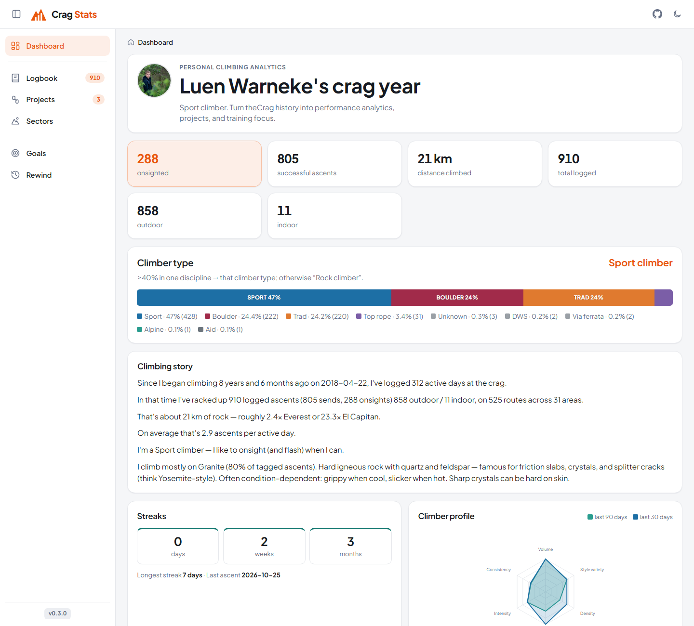
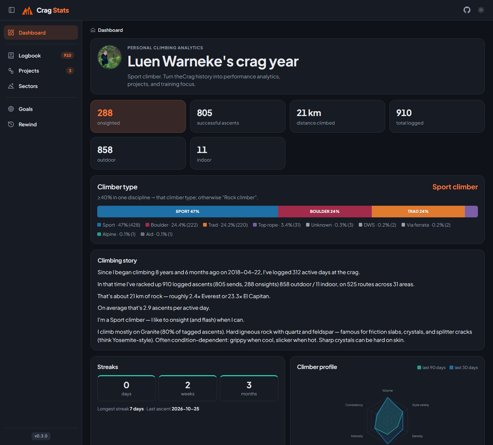
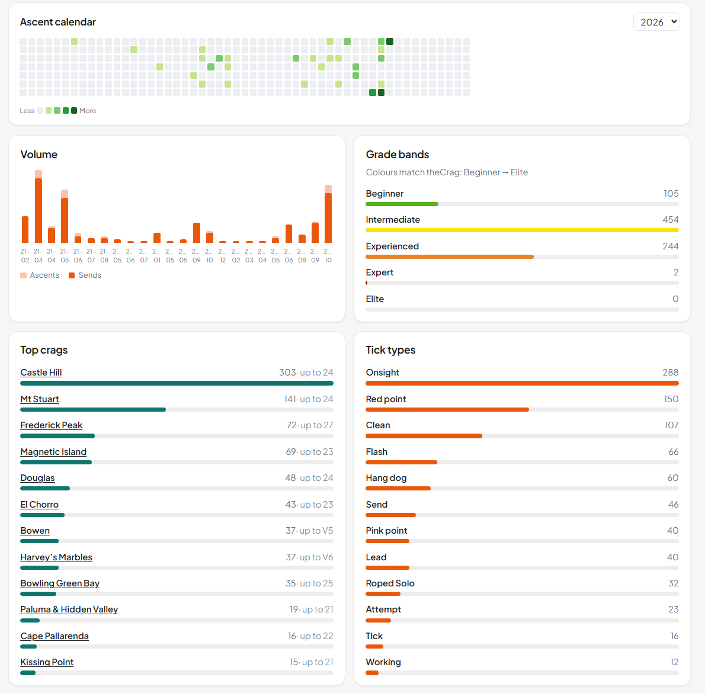
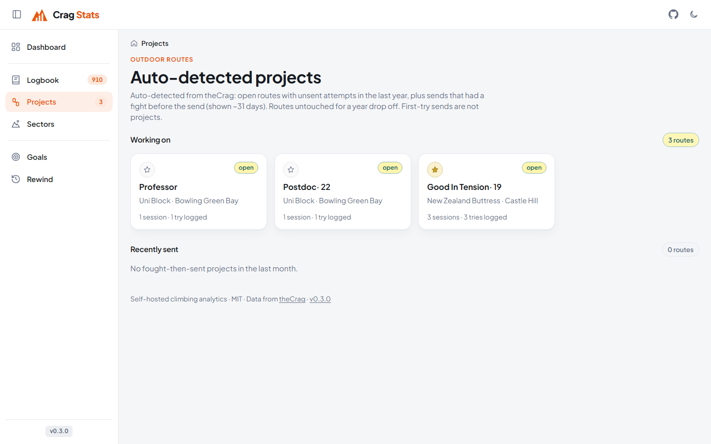
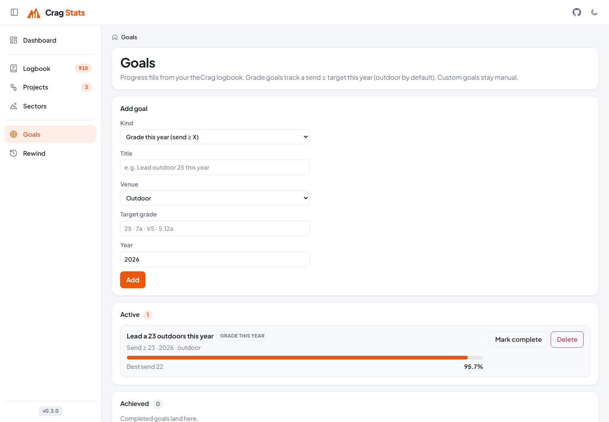
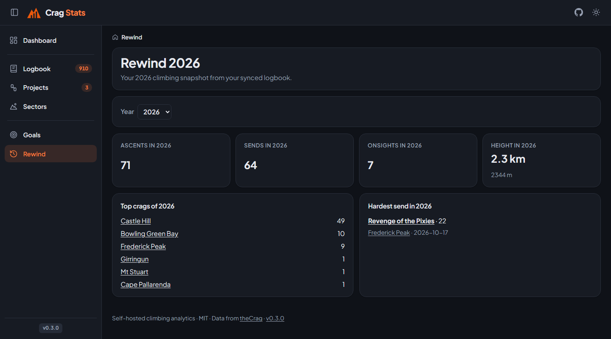
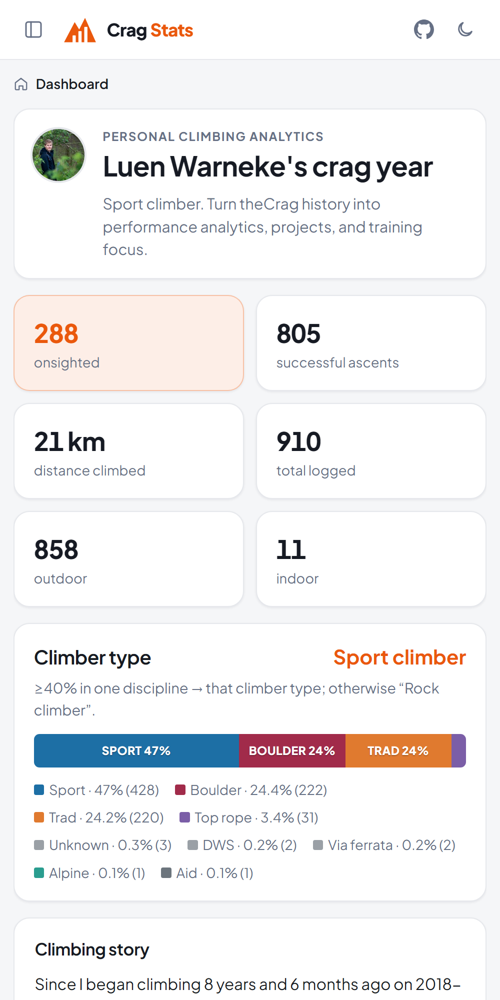

<p align="center">
  
</p>

<h1 align="center">Crag Stats</h1>

<p align="center">
  <a href="./LICENSE"></a>
  <a href="https://github.com/Luen/crag-stats/releases"></a>
  <a href="https://github.com/Luen/crag-stats/actions/workflows/ci.yml"></a>
  <a href="https://github.com/Luen/crag-stats/pkgs/container/crag-stats"></a>
</p>

<p align="center">
  <strong>Crag Stats is a self-hosted, open-source analytics dashboard for your <a href="https://www.thecrag.com/">theCrag</a> climbing logbook.</strong>
</p>

<p align="center">
  <em>Grade pyramids, CPR, training load, projects, first ascents, badges, weather, a world map and shareable stat cards. Your data stays on your machine.</em>
</p>

<p align="center">
  <a href="#-showcase">Showcase</a> •
  <a href="#run-crag-stats-on-your-own-computer-docker">Run on your computer</a> •
  <a href="#quick-start-local">Developer setup</a> •
  <a href="#homeserver-deploy-recommended">Deploy</a> •
  <a href="./docs/dev/BRANDING.md">Design guide</a>
</p>

Inspired by [Dreeve](https://dreeve.app/) (Stats for Strava) and [RoxClimbs](https://roxclimbs.com/). **AGPL-3.0 licensed.**

## 📸 Showcase

<p align="center">
  
</p>

<table>
  <tr>
    <td width="50%"><br /><sub><b>Dark mode</b>: follows your OS, or toggle it in the header</sub></td>
    <td width="50%"><br /><sub><b>Charts</b>: ascent calendar, volume, theCrag grade bands, crags and tick types</sub></td>
  </tr>
  <tr>
    <td><br /><sub><b>Projects</b>: auto-detected from unsent attempts</sub></td>
    <td><br /><sub><b>Goals</b>: progress fills from your logbook</sub></td>
  </tr>
  <tr>
    <td><br /><sub><b>Rewind</b>: your year at a glance</sub></td>
    <td align="center"><br /><sub><b>Mobile</b>: the sidebar becomes a slide-out menu, and collapses to an icon rail on desktop</sub></td>
  </tr>
</table>

## Features

### Your logbook, kept in sync

- **theCrag API sync:** uses your personal Logbook Read API key. Every sync is a full reconcile (new and edited ticks are updated, deleted ones removed), on a daily schedule. A fresh install syncs as soon as it starts. theCrag stays the source of truth.
- **CSV import** for climbers without supporter API access: upload theCrag's logbook export in Settings whenever you want to refresh (adds and updates only). See [logbook sync](docs/guide/logbook-sync.md).
- **Sync summaries:** Settings reports how many ascents were processed, added, refreshed and removed after each run. You can also export your local logbook as CSV.
- **Logbook:** search, sort and filter by style, tick type, crag, sector, grade range, dates and season, partners, quality and stars, rock type, tags, FA/FFA, solo type, weather and more, with theCrag-style tick icons. Most dashboard cards link straight to the matching ascents.

### Dashboard

- **Climber type, climber profile radar, grade pyramids** per discipline, grade bands, **notable ascents**, **hardest sends** (routes and boulders ranked separately), volume, height, top crags and tick types.
- **Ascent calendar** (intensity or weather), **sessions per week**, **weekday** split, **best months**, monthly and yearly stats, style mix, stars and quality, rock types.
- **CPR timelines:** an approximation of theCrag's Climber Performance Rating.
- **Training load:** an intensity-weighted fatigue/fitness model that flags spikes. Working an ungraded route counts as climbing at your max.
- **Eddington numbers:** send days, vertical days, and route and boulder grade indexes.
- **First ascents:** mark your FAs and FFAs in the logbook (or import them from public route history) to get a card with counts, grade ranges, styles, routes you set and community ascents on your routes.
- **Solo climbing:** top-rope solo, lead solo, free solo, deep water solo and aid solo, plus ascents with no partner tagged.
- **Badges & milestones:** 90+ badges dated by the climb that earned them (newest first), including distance climbed up to 150 km, streaks, holidays, weather and first ascents. Badges and ascent cards name the partners you climbed with.
- **Route popularity** (busy vs quiet crags, hidden gems), **karma**, **partners**, streaks and a **climbing story** written from your logbook.
- **Weather conditions** (optional): heat, freeze, rain, snow, wind, fair and perfect days, and whether you climb in fair or tough weather.
- **Customize the dashboard** (which cards and in what order) from Settings. Route and boulder grade systems are site-wide.
- **How it works** pages at `/docs` for every analytic, linked from each card.

### More pages

- **Projects** auto-detected from unsent attempts and recently sent projects. Ungraded routes get a "New route?" badge.
- **Goals** with progress bars that fill from your logbook. Only the owner can add or change them.
- **Badges** gallery with locked badges and an "Almost there" list, plus **Milestones**, **Eddington**, **Training load** and **Activity** (monthly and yearly tables) detail pages.
- **Partners** leaderboard by ascents, sessions or areas.
- **Sectors** grouped by crag and area, with visit-day weather.
- **World map** of everywhere you've climbed, drawn from bundled map data with no third-party requests.
- **Seasonality** search: which of your logged crags and routes are in season in a given month.
- **Rewind:** your year at a glance.

### Optional route data and weather

- **Route data import** (`ROUTE_DATA_IMPORT`): fetches route details (popularity, ascent counts, quality, seasonality, pitches) and public history for FA/FFA marks, slowly and politely in the background.
- **Weather import** (`WEATHER_IMPORT`): caches daily weather from [Open-Meteo](https://open-meteo.com/) for your outdoor climbing days. You can pick a nearby town in Settings when a crag has no usable location.
- Settings shows live progress while either import runs.

### Share

- **Share & embed:** live SVG stat cards (summary, Eddington numbers, hardest sends) for blogs and forum profiles, in light or dark, with copyable HTML or Markdown. The page warns you when the site is only reachable on your local network.
- **Installable app with offline copy:** download a read-only snapshot of your public dashboard totals and logbook to view without a connection.

### Privacy & self-hosting

- **Optional password gate** (`APP_PASSWORD` / `AUTH_SCOPE`), a search-engine visibility toggle, and a one-click wipe.
- **Private notes are hidden by default.** You can opt in to see them yourself; visitors never see them, and they never reach offline copies, embeds or share cards.
- **Docker / GHCR:** multi-arch images (`amd64` + `arm64`) on a minimal distroless runtime, with database migrations applied automatically on start. Upgrading straight from any older release is tested.
- **Nightly dependency updates:** in-major upgrades with a 3-day cooldown and the full test suite; a patch release (and image) only when something that ships in the image moved. Lint, format, typecheck and test tooling updates are committed without releasing.
- **Dreeve-style UI:** light and dark themes, a collapsible sidebar and a mobile drawer.
- Provider-shaped architecture, ready for Mountain Project later.

Contributor / agent notes: see [AGENTS.md](./AGENTS.md) (living document).

## Run Crag Stats on your own computer (Docker)

Crag Stats turns your theCrag logbook into a dashboard you open in your browser.
Docker runs the app and stores its data on your computer. You do not need to
install Git, Node.js, or pnpm, or download the source code.

You will need an internet connection to download the app and import data, and a
theCrag account. Automatic logbook sync requires a **supporter Logbook Read API
key**. Without one, you can upload your logbook CSV by hand instead (see step 5).

### 1. Download and install Docker Desktop

- **Windows:** follow [Docker's Windows installation guide](https://docs.docker.com/desktop/setup/install/windows-install/). Run the installer, use the WSL 2 backend, and follow any prompts to set up WSL or restart your computer. Crag Stats uses **Linux containers**.
- **macOS:** follow [Docker's Mac installation guide](https://docs.docker.com/desktop/setup/install/mac-install/). Choose the download for your chip (**Apple silicon** or **Intel**, shown under Apple menu → About This Mac), open the downloaded `.dmg`, and drag Docker into Applications.

Open **Docker Desktop**, finish its setup, and wait until its engine is running.
Keep Docker Desktop running whenever you want to use Crag Stats.

### 2. Open a terminal and download two setup files

A terminal is a window where you paste commands and press Enter. On **Windows**,
open Start, type **PowerShell**, and open it. On **macOS**, open Spotlight
(Command + Space), type **Terminal**, and press Enter.

Run only the block for your operating system, one line at a time. These commands
create a `crag-stats` folder in your home folder and download the startup file
and a settings template. Use a new folder for first-time setup: downloading
`.env` again would replace settings you already saved.

**Windows (PowerShell):**

```powershell
New-Item -ItemType Directory -Force -Path "$HOME/crag-stats" | Out-Null
Set-Location "$HOME/crag-stats"
curl.exe -fsSL https://raw.githubusercontent.com/Luen/crag-stats/main/docker-compose.ghcr.yml -o docker-compose.ghcr.yml
curl.exe -fsSL https://raw.githubusercontent.com/Luen/crag-stats/main/.env.example -o .env
notepad .env
```

**macOS (Terminal; also works in a Linux terminal with Docker Engine and Compose installed):**

```bash
mkdir -p ~/crag-stats
cd ~/crag-stats
curl -fsSL https://raw.githubusercontent.com/Luen/crag-stats/main/docker-compose.ghcr.yml -o docker-compose.ghcr.yml
curl -fsSL https://raw.githubusercontent.com/Luen/crag-stats/main/.env.example -o .env
nano .env
```

### 3. Fill in your settings

The last command opens `.env`, a plain-text settings file. In it, replace the
values on these existing lines:

```dotenv
THECRAG_API_KEY='paste-your-theCrag-logbook-read-key-here'
APP_PASSWORD='choose-your-own-Crag-Stats-password'
SESSION_SECRET='replace-with-a-long-random-secret'
AUTH_SCOPE=all
```

- Get your **Logbook Read API key** from [theCrag → API keys](https://www.thecrag.com/settings/apikey) while signed in. Paste the key between the quotes. If you do not have supporter API access, leave `THECRAG_API_KEY=` empty and use CSV import in step 5.
- `APP_PASSWORD` is a new password you choose for **Crag Stats**. It is the password you will enter in your browser.
- `SESSION_SECRET` is a separate random value used internally. Generate one with your password manager (at least 32 random letters and digits), then paste it between the quotes. You do not need to memorise it.
- `AUTH_SCOPE=all` asks for your Crag Stats password before showing any page.

For the fullest dashboard, enable **both** optional imports. Find
`# ROUTE_DATA_IMPORT=false` and `# WEATHER_IMPORT=false`, remove their leading
`#`, and change them to:

```dotenv
ROUTE_DATA_IMPORT=true
WEATHER_IMPORT=true
```

Route data adds route details and first-ascent history; weather adds historical
conditions for outdoor climbing days. These run gradually in the background.
Route data uses theCrag's route API with browser impersonation; read the
[route import notes](docs/dev/ROUTE_HISTORY.md) before opting in. Weather uses
Open-Meteo's free non-commercial service for personal use.

You can also uncomment `TZ=Australia/Brisbane` and replace it with your own
[IANA time zone](https://en.wikipedia.org/wiki/List_of_tz_database_time_zones)
so scheduled syncs and displayed times use your zone.

Leave `HOST`, `PORT`, and `DATABASE_PATH` as supplied. The Compose file handles
the Docker-specific values. Local browser access defaults to
`HOST_BIND=127.0.0.1` and `HOST_PORT=8097`; keep those defaults for access from
this computer only.

**Save and close:** in Notepad, press Ctrl + S, then close the window; make sure
the filename remains exactly `.env`, not `.env.txt`. In nano, press
Ctrl + O, Enter, then Ctrl + X.

Keep `.env` private: it contains your key, password, and secret. API keys can
read private ascent notes.

### 4. Download and start Crag Stats

Back in the same terminal window, run these commands (the same on both systems):

```sh
docker compose -f docker-compose.ghcr.yml pull
docker compose -f docker-compose.ghcr.yml up -d
```

The first command downloads the ready-made app from GitHub Container Registry
(GHCR); the second starts the app and its background worker. The first download
can take a few minutes. Once the commands finish, you can close the terminal.

### 5. Open your dashboard

Open **[http://localhost:8097](http://localhost:8097)** in a browser on the
**same computer** and sign in with the `APP_PASSWORD` you chose.

With an API key configured, a fresh installation starts its first logbook sync
automatically. Open the gear icon → **Settings** to check progress or choose
**Sync now**. Your dashboard fills as data arrives; route and weather enrichment
can take longer and continue over later runs. Keep the app running while it works.

**No supporter API key?** On theCrag, open your logbook and choose
**Action → Export logbook as CSV**. In Crag Stats, open **Settings → CSV import**
and upload that file. Repeat this yourself when you want to import new ticks.
See [logbook sync](docs/guide/logbook-sync.md) for details.

Use the sidebar to explore your logbook, pyramids, projects, and badges. You
continue recording and editing climbs on theCrag; Crag Stats brings those
changes into your local dashboard through sync.

### Using it again, stopping it, and updating it

For later commands, first return to your setup folder:

- **Windows PowerShell:** `Set-Location "$HOME/crag-stats"`
- **macOS Terminal:** `cd ~/crag-stats`

To stop Crag Stats:

```sh
docker compose -f docker-compose.ghcr.yml stop
```

To start it again, open Docker Desktop, wait for its engine, then run:

```sh
docker compose -f docker-compose.ghcr.yml up -d
```

Open [http://localhost:8097](http://localhost:8097) again. It is available while
your computer and Docker are running and the containers are started. Your
climbing data is stored in a Docker volume and survives stops and app updates.
Do not delete that volume if you want to keep your data and settings; see the
[backup guide](docs/guide/logbook-sync.md#backup-keep-a-local-copy).

To download and use the latest image:

```sh
docker compose -f docker-compose.ghcr.yml pull
docker compose -f docker-compose.ghcr.yml up -d
```

After editing `.env` later, run `docker compose -f docker-compose.ghcr.yml up -d`
again to apply the new settings.

### If something does not work

- **`docker` is not recognised / command not found:** finish installing Docker Desktop and open a new terminal window.
- **Cannot connect to the Docker daemon:** open Docker Desktop and wait for its engine to start. On Windows, check that it is using Linux containers.
- **Missing Compose file or `.env`:** return to your `crag-stats` folder and check that both downloads succeeded. On Windows, check for an accidental `.env.txt` filename.
- **Browser cannot connect:** wait a little after starting the app, then run `docker compose -f docker-compose.ghcr.yml ps` to check the app and worker, or `docker compose -f docker-compose.ghcr.yml logs --tail=100` to see startup errors.
- **Port 8097 is already in use:** add `HOST_PORT=8098` to `.env`, run the `up -d` command again, and open [http://localhost:8098](http://localhost:8098).
- **Dashboard is empty:** check **Settings** for sync errors. Verify your Logbook Read key, or upload a CSV if you have no supporter key. After changing the key in `.env`, run the `up -d` command again.

## Quick start (local)

For contributors running the source code:

Requires [pnpm](https://pnpm.io/) (Node 26 LTS+).

```bash
cp .env.example .env
# optional: set THECRAG_API_KEY and APP_PASSWORD

pnpm install
pnpm test   # unit tests (also run in CI)
pnpm check
pnpm dev
```

Open http://localhost:5173 — then **`/settings`** → sync API or upload CSV. The gear icon in the header opens the same page.

### Admin access (`/settings` and `/login`)

- **`/settings`** — sync, wipe, route and boulder grade systems, private notes, dashboard layout, and other owner controls.
- **`/login`** — unlock with `APP_PASSWORD` when that env var is set. Visiting `/settings` (or any protected route) while logged out redirects here (`/login?next=…`).
- With no `APP_PASSWORD`, `/settings` is open to anyone who can reach the host — fine on localhost or a private LAN; set a password (and prefer Cloudflare Access in front of public tunnels) before exposing the app.
- `AUTH_SCOPE=settings` (default) only gates admin; `AUTH_SCOPE=all` requires login for the whole UI.

## Homeserver deploy (recommended)

Public images are published to GitHub Container Registry on each version tag (`gh release create` pushes one):

`ghcr.io/luen/crag-stats:latest`, plus version tags like `0.5.1`, `0.5` and `0` (no `v` prefix).

```bash
cp .env.example .env
# API: THECRAG_API_KEY — or no key: upload your theCrag CSV export in Settings → CSV import
# optional APP_PASSWORD; see docs/guide/logbook-sync.md (also /docs/logbook-sync in the app)

docker compose -f docker-compose.ghcr.yml pull
docker compose -f docker-compose.ghcr.yml up -d
```

More deploy detail (proxies, upgrades, release): [docs/DEPLOY.md](docs/DEPLOY.md).

Pin a release:

```bash
CRAG_STATS_IMAGE_TAG=0.5 docker compose -f docker-compose.ghcr.yml up -d
```

Upgrades:

```bash
docker compose -f docker-compose.ghcr.yml pull
docker compose -f docker-compose.ghcr.yml up -d
```

**Database migrations run automatically** on container start (`scripts/docker-entrypoint.mjs` + `/migrations/*.sql`). Your SQLite volume is preserved across upgrades, and you can skip releases: every pending migration is applied in order. That's covered by a test that upgrades every older schema to the latest.

The minimal Debian/glibc runtime starts the app and worker with `node` and contains no shell or package manager; build tooling remains in the build stage. Use `node scripts/migrate.mjs` for manual migration commands inside a container.

### Build locally instead

```bash
docker compose up --build -d
```

## Environment

| Variable                  | Purpose                                                                                                                                                                                                                                                                                                  |
| ------------------------- | -------------------------------------------------------------------------------------------------------------------------------------------------------------------------------------------------------------------------------------------------------------------------------------------------------- |
| `THECRAG_API_KEY`         | Personal logbook read key ([docs](https://www.thecrag.com/en/article/logbookreadapi))                                                                                                                                                                                                                    |
| `APP_PASSWORD`            | Optional UI password gate. Sign in at `/login`; admin lives at `/settings`                                                                                                                                                                                                                               |
| `AUTH_SCOPE`              | `settings` (default: protect `/settings` and related admin actions only) or `all` (whole site; also forces search engines off)                                                                                                                                                                           |
| `SESSION_SECRET`          | Cookie signing and worker authentication                                                                                                                                                                                                                                                                 |
| `DATABASE_PATH`           | SQLite file path                                                                                                                                                                                                                                                                                         |
| `SYNC_CRON`               | Cron expression (default `0 6 * * *`); `off` disables scheduled and boot-time sync                                                                                                                                                                                                                       |
| `ORIGIN`                  | Public URL, only needed behind a proxy that doesn't send `X-Forwarded-Proto` (see [DEPLOY.md](docs/DEPLOY.md#http-https-and-reverse-proxies))                                                                                                                                                            |
| `DISPLAY_LOCALE` / `TZ`   | Locale (default `en-AU`) and IANA time zone used to display dates and times                                                                                                                                                                                                                              |
| `ROUTE_DATA_IMPORT`       | `true` to import route data (details such as popularity, ascent counts, quality, seasonality and pitches, plus public history for FA/FFA marks) from theCrag in the background (default `false`): once per route, 100 per run, ≤1 request/s. See [docs/dev/ROUTE_HISTORY.md](docs/dev/ROUTE_HISTORY.md). |
| `ROUTE_DATA_REFRESH_DAYS` | Optional route-data refresh age: whole days 30–3650 (e.g. `90` recommended, `180` ≈ half a year); unset/`0`/`<30`/`>3650` keeps fetch-once behavior. Requires `ROUTE_DATA_IMPORT=true`. Runs after successful syncs within the same 100-route limit, prioritizing new routes then oldest stale data.     |
| `WEATHER_IMPORT`          | `true` to cache outdoor daily weather from Open-Meteo after sync (default `false`): 50 days per run, ≤1 request/s, heat/freeze/rain/snow/wind badges. Free non-commercial tier for personal self-hosted installs; see [docs/guide/weather.md](docs/guide/weather.md).                                    |

Grade systems and private ascent notes are configured in **Settings** (stored in SQLite), not via environment variables. If an older install set `PREFERRED_GRADE_SYSTEM` or `SHOW_PRIVATE_NOTES`, the first start after upgrading copies them into Settings (unless Settings already has a value).

## Privacy

theCrag API keys expose **private notes**. Do not commit `.env`. Revoking a key does not delete data already synced locally — use **Settings → Wipe**. See [docs/PRIVACY.md](docs/PRIVACY.md).

## License

Copyright (c) 2026 Crag Stats contributors.

Licensed under the [GNU Affero General Public License v3.0 (AGPL-3.0)](./LICENSE).
