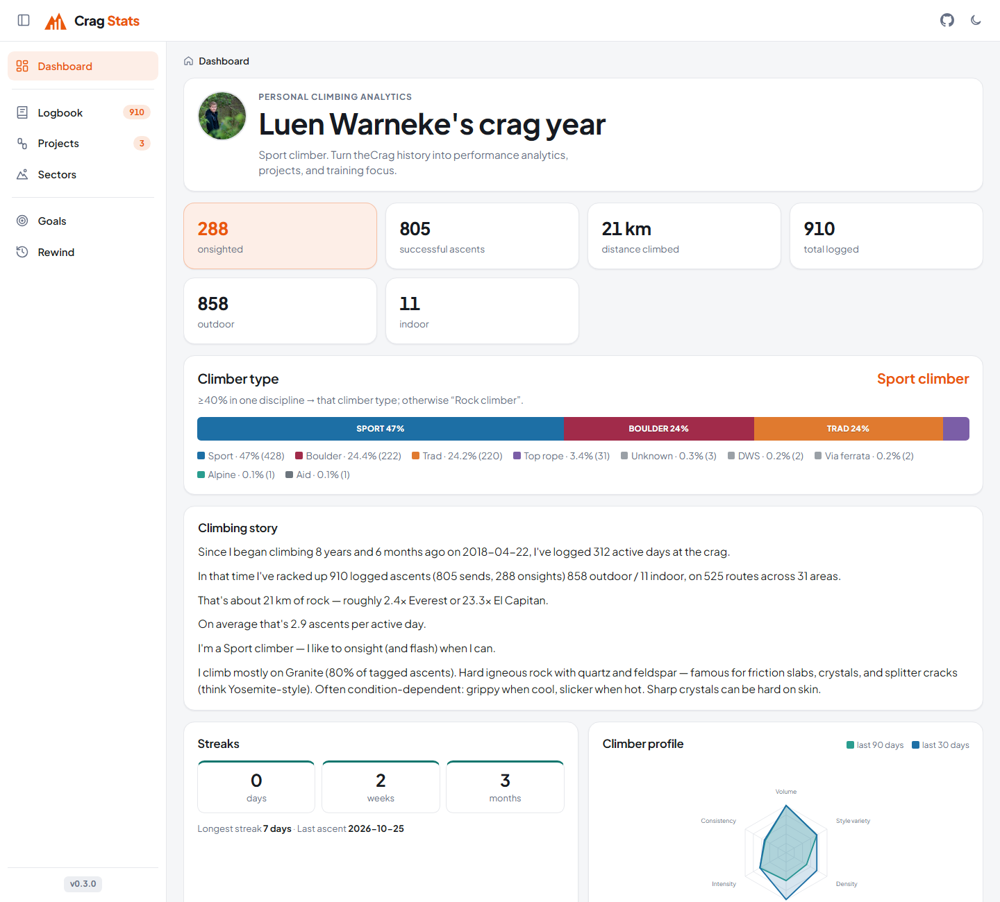
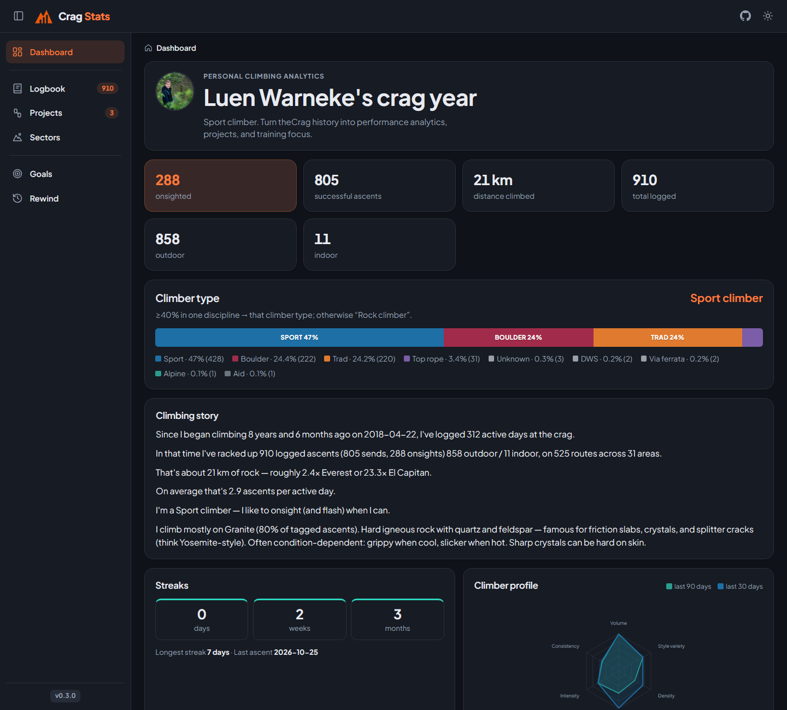
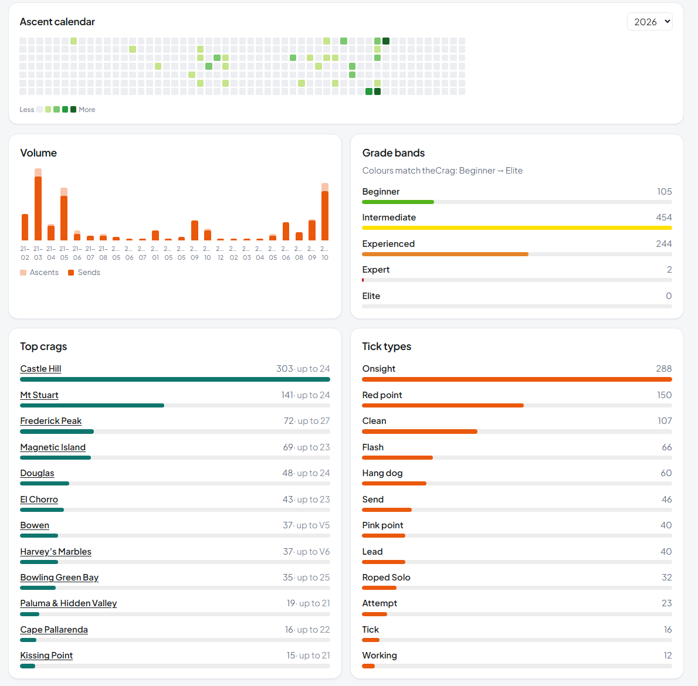
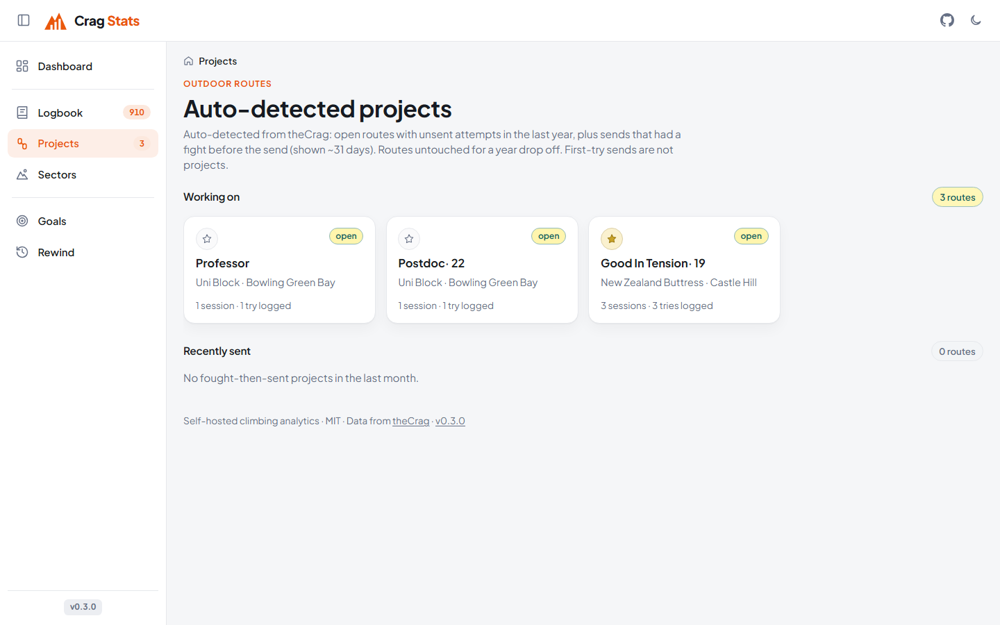
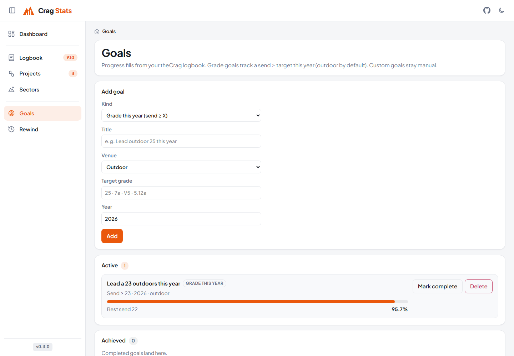
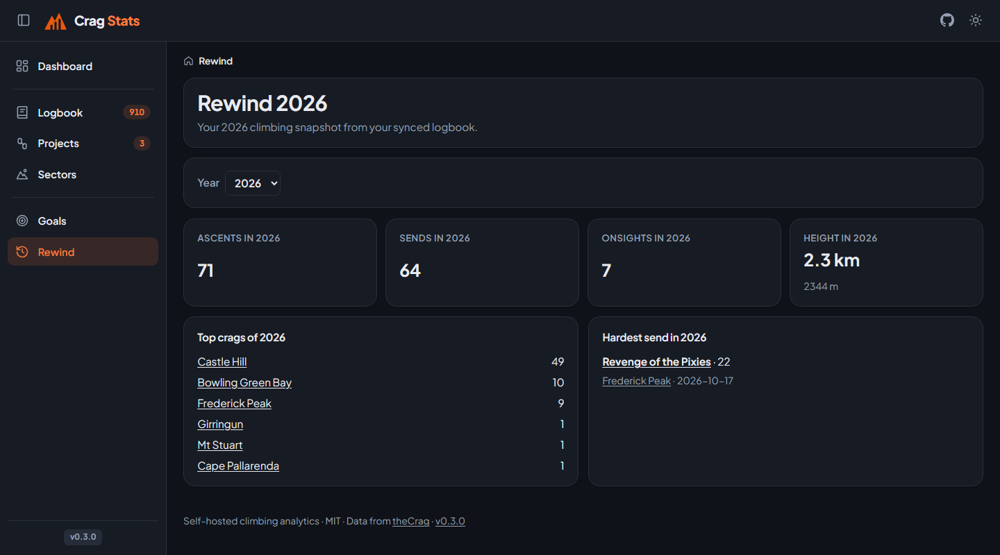
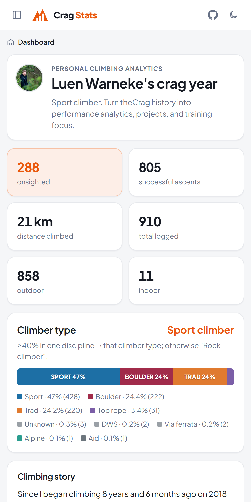

<p align="center">
  
</p>

<h1 align="center">Crag Stats</h1>

<p align="center">
  <a href="./LICENSE"></a>
  <a href="https://github.com/Luen/crag-stats/releases"></a>
  <a href="https://github.com/Luen/crag-stats/actions/workflows/ci.yml"></a>
  <a href="https://github.com/Luen/crag-stats/pkgs/container/crag-stats"></a>
</p>

<p align="center">
  <strong>Crag Stats is a self-hosted, open-source analytics dashboard for your <a href="https://www.thecrag.com/">theCrag</a> climbing logbook.</strong>
</p>

<p align="center">
  <em>Grade pyramids, CPR timelines, projects, goals and a yearly rewind. Your data stays on your machine.</em>
</p>

<p align="center">
  <a href="#-showcase">Showcase</a> •
  <a href="#quick-start-local">Quick start</a> •
  <a href="#homeserver-deploy-recommended">Deploy</a> •
  <a href="./docs/dev/BRANDING.md">Design guide</a>
</p>

Inspired by [Dreeve](https://dreeve.app/) (Stats for Strava) and [RoxClimbs](https://roxclimbs.com/). **MIT licensed.**

## 📸 Showcase

<p align="center">
  
</p>

<table>
  <tr>
    <td width="50%"><br /><sub><b>Dark mode</b>: follows your OS, or toggle it in the header</sub></td>
    <td width="50%"><br /><sub><b>Charts</b>: ascent calendar, volume, theCrag grade bands, crags and tick types</sub></td>
  </tr>
  <tr>
    <td><br /><sub><b>Projects</b>: auto-detected from unsent attempts</sub></td>
    <td><br /><sub><b>Goals</b>: progress fills from your logbook</sub></td>
  </tr>
  <tr>
    <td><br /><sub><b>Rewind</b>: your year at a glance</sub></td>
    <td align="center"><br /><sub><b>Mobile</b>: the sidebar becomes a slide-out menu, and collapses to an icon rail on desktop</sub></td>
  </tr>
</table>

## Features

- **theCrag API sync** — personal Logbook Read API key; full reconcile on every sync (upsert + prune deletes) + daily schedule. Upstream is source of truth.
- **CSV import** — full logbook export for users without supporter API access (upsert only)
- **Dashboard** — climber type, style pyramids, notable ascents, CPR timelines, volume, height, top crags
- **Grade bands & colours** — Beginner → Elite palette aligned with [theCrag grades](https://www.thecrag.com/en/article/grades); site-wide grade system set in Settings
- **Logbook** — searchable / filterable ascent history with theCrag-like tick icons
- **Projects, goals & rewind** — auto-detected projects, goal progress bars, yearly snapshot
- **Dreeve-style UI** — light/dark themes, collapsible sidebar, mobile drawer
- **Privacy controls** — optional password gate (`APP_PASSWORD` / `AUTH_SCOPE`), search-engine visibility toggle, one-click wipe
- **Docker / GHCR** — public multi-arch images (`amd64` + `arm64`) with automatic DB migrations on boot
- Provider-shaped architecture ready for Mountain Project later

Contributor / agent notes: see [AGENTS.md](./AGENTS.md) (living document).

## Quick start (local)

Requires [pnpm](https://pnpm.io/) (Node 24 LTS+).

```bash
cp .env.example .env
# optional: set THECRAG_API_KEY and APP_PASSWORD

pnpm install
pnpm test   # grade / URL / ascent mapping unit tests (also runs in CI)
pnpm check
pnpm dev
```

Open http://localhost:5173 — then **Settings** → sync API or upload CSV.

## Homeserver deploy (recommended)

Public images are published to GitHub Container Registry on each version tag / release:

`ghcr.io/luen/crag-stats:latest` (also semver tags like `v0.1.0`)

```bash
cp .env.example .env
# set THECRAG_API_KEY / SESSION_SECRET / optional APP_PASSWORD

docker compose -f docker-compose.ghcr.yml pull
docker compose -f docker-compose.ghcr.yml up -d
```

Pin a release:

```bash
CRAG_STATS_IMAGE_TAG=v0.1.0 docker compose -f docker-compose.ghcr.yml up -d
```

Upgrades:

```bash
docker compose -f docker-compose.ghcr.yml pull
docker compose -f docker-compose.ghcr.yml up -d
```

**Database migrations run automatically** on container start (`scripts/docker-entrypoint.mjs` + `/migrations/*.sql`). Your SQLite volume is preserved across upgrades.

### Build locally instead

```bash
docker compose up --build -d
```

## Environment

| Variable                 | Purpose                                                                                                                                       |
| ------------------------ | --------------------------------------------------------------------------------------------------------------------------------------------- |
| `THECRAG_API_KEY`        | Personal logbook read key ([docs](https://www.thecrag.com/en/article/logbookreadapi))                                                         |
| `APP_PASSWORD`           | Optional UI password gate                                                                                                                     |
| `AUTH_SCOPE`             | `settings` (default: protect admin only) or `all` (whole site; also forces search engines off)                                                |
| `SESSION_SECRET`         | Cookie + worker shared secret                                                                                                                 |
| `DATABASE_PATH`          | SQLite file path                                                                                                                              |
| `SYNC_CRON`              | Cron expression (default `0 6 * * *`)                                                                                                         |
| `ORIGIN`                 | Public URL, only needed behind a proxy that doesn't send `X-Forwarded-Proto` (see [DEPLOY.md](docs/DEPLOY.md#http-https-and-reverse-proxies)) |
| `DISPLAY_LOCALE` / `TZ`  | Locale (default `en-AU`) and IANA time zone used to display dates and times                                                                   |
| `PREFERRED_GRADE_SYSTEM` | Default grade system until one is saved in Settings: `ewbank` / `french` / `yds` / `v_scale` / `font`                                         |
| `SHOW_PRIVATE_NOTES`     | `true` to show your private ascent notes in the logbook (default `false`). Only people who can open Settings see them. Settings overrides it. |

## Privacy

theCrag API keys expose **private notes**. Do not commit `.env`. Revoking a key does not delete data already synced locally — use **Settings → Wipe**. See [docs/PRIVACY.md](docs/PRIVACY.md).

## Roadmap / epics

Tracked as GitHub issues on this repo (`Epic:` prefix): foundation, providers, API sync, CSV import, dashboard, analytics, projects, Mountain Project, training/wearables, docs/privacy, i18n/Crowdin.

## License

[MIT](./LICENSE)
